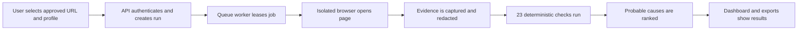
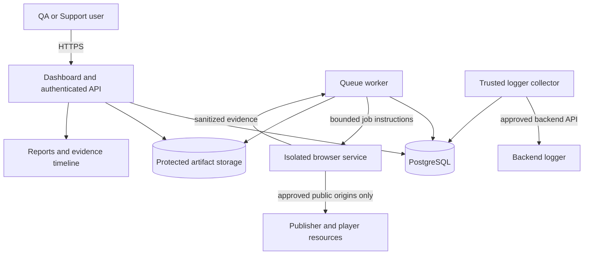
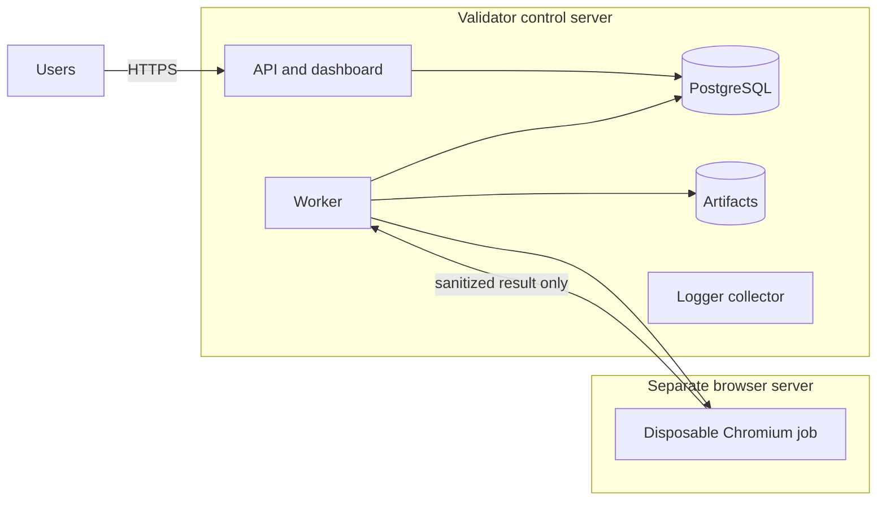

# VDO.AI Automated Player Testing (APT) Tool

The APT Tool checks whether a VDO.AI player is installed and behaving correctly on a publisher page. A user submits an approved page, the tool observes the player in a controlled browser, evaluates 23 defined test cases, and produces a report with evidence and likely causes.

The product is designed for QA, Ad Operations, Support, Player Engineering, and publisher implementation teams. It reduces repeated manual inspection while keeping every conclusion traceable to captured evidence.

> **Current status — 20 October 2026:** all 23 case rules and the planned local product functions are implemented. The application is still in internal-pilot status. It has not completed production deployment acceptance or validation against an approved live publisher corpus, so it does not yet claim production accuracy or live publisher certification.

## What the application does

The application can:

- accept a single approved page or a bounded batch of page and device combinations;
- test pages in an isolated Chromium session;
- inspect player scripts, tags, DOM placement, logger events, dependencies, ads, layout, viewability, devices, and article transitions;
- retain screenshots, sanitized network evidence, event timelines, and report references;
- classify results as `PASS`, `FAIL`, `WARNING`, `UNKNOWN`, or `NOT APPLICABLE`;
- identify the earliest evidence-supported failure and suggest the most likely owning team;
- show team-scoped run history in a dashboard;
- export redacted JSON and self-contained HTML reports;
- optionally compare browser evidence with a backend logger when an approved shared identifier exists;
- optionally create an AI-written explanation without allowing AI to change test results.

The tool does not guess missing facts. When the page, policy, device, or evidence is insufficient, it reports an explicit coverage gap.

## Who uses it

| User | Typical use |
| --- | --- |
| QA | Run repeatable release and regression checks across desktop and mobile profiles |
| Ad Operations | Confirm the expected tag, domain, product, ad-request path, and configuration |
| Publisher Support | Investigate why a player is missing, blocked, slow, hidden, or not monetizing |
| Player Engineering | Inspect event sequence, dependencies, runtime errors, lifecycle, and timing |
| Measurement teams | Review formation, viewport exposure, and viewable-impression evidence |
| Product and leadership | Track pilot coverage, accuracy, turnaround time, and release readiness |

## How a validation works



1. The user signs in with a team token.
2. The user selects an approved page, integration profile, and device.
3. The application creates a bounded job with a deadline.
4. A controlled browser loads the page and records permitted evidence.
5. The rule engine compares observed behavior with the approved profile.
6. The application stores results, evidence references, and likely causes.
7. The dashboard presents the result and offers JSON or offline HTML export.

## Application architecture

The application uses separate responsibilities so that an untrusted publisher page cannot access internal credentials or databases.



| Component | Purpose |
| --- | --- |
| Dashboard | Submit tests and inspect history, coverage, failures, evidence, and probable causes |
| Authenticated API | Enforce identity, team boundaries, run admission, status, reports, and artifact access |
| PostgreSQL | Store profiles, runs, queue state, check results, findings, and artifact references |
| Queue worker | Claim jobs, enforce deadlines and retries, and coordinate browser execution |
| Browser service | Open the publisher page with real Chromium and collect bounded evidence |
| Rule engine | Apply versioned, deterministic rules to the captured evidence |
| RCA engine | Group dependent symptoms and rank supported causes without inventing evidence |
| Artifact storage | Retain bounded screenshots, sanitized network evidence, and report artifacts |
| Logger collector | Optionally retrieve authorized server-side logger records without sharing its credential |
| Report exporter | Create redacted JSON and self-contained HTML reports |
| Pilot evaluator | Measure accuracy, latency, completeness, cost coverage, and release gates from a labeled corpus |

The repository contains the application logic, local API, dashboard, PostgreSQL queue, browser runner, rule engine, reports, and pilot evaluator. The separate production browser service, long-running worker process, and trusted collector deployment boundaries remain part of the Coolify deployment work.

## How to use the application

### Current internal/local workflow

Requirements: Node.js 24 or newer, `pnpm`, PostgreSQL, and an installed Chromium browser for browser-level testing.

```bash
pnpm install
pnpm typecheck
pnpm test
```

Set `DATABASE_URL`, `VDO_VALIDATOR_API_IDENTITIES`, and `VDO_VALIDATOR_ARTIFACT_ROOT`, then start the application:

```bash
pnpm api
```

Open `http://127.0.0.1:8787`, enter an authorized team token, submit an approved fixture profile and URL, choose a device, and follow the run until its report becomes available.

From the dashboard a user can:

1. submit a single run or bounded batch;
2. monitor queued, running, completed, failed, or timed-out work;
3. review case coverage and verdict totals;
4. inspect the evidence timeline and probable causes;
5. download redacted JSON or offline HTML.

See the [complete non-technical product guide](docs/product-guide.md) for roles, result interpretation, limitations, and the end-to-end user journey. Technical operators can use the [API guide](docs/api.md), [dashboard guide](docs/dashboard.md), [batch guide](docs/batches.md), and [report export guide](docs/report-export.md).

### Production workflow after deployment acceptance

1. An administrator approves the site, exact page URLs, expected tags, resource origins, device policy, and rule versions.
2. Deployment owners prove browser isolation, network restrictions, backup recovery, secret separation, and monitoring.
3. An operator submits an approved live URL from the dashboard or API.
4. The isolated browser service performs the run.
5. QA or Support reviews the report and assigns supported findings to the suggested owner.
6. Results from the labeled pilot corpus feed the release evaluator.

Remote publisher execution stays disabled until the production acceptance document matches the deployed browser image, profiles, and origins.

## The 23 test cases

| Case | Plain-language check |
| --- | --- |
| TC-1 | Is the correct VDO.AI tag and loader script present and successfully loaded? |
| TC-2 | Did the loader script finish within the approved timing bands? |
| TC-3 | Did each tag load only once without duplicate scripts or anchors? |
| TC-4 | Are browser logger requests being sent successfully? |
| TC-5 | Does the observed logger event journey match an approved served-ad or no-ad flow? |
| TC-6 | Are all events required for this page, product, and outcome present? |
| TC-7 | Is Pageview emitted once per active tag and Website Pageview within its allowed count? |
| TC-8 | Is the player correctly classified above or below the fold, and does it report entering view? |
| TC-9 | Does an eligible player initiate the expected ad request? |
| TC-10 | Where does the ad-serving chain first stop, and was viewable exposure achieved? |
| TC-11 | Were player, inline, autoplay, IMA, agent, device, URL, or coded errors blocked as expected? |
| TC-12 | Did every dependency required by the selected product load successfully? |
| TC-13 | Are the correct anchor and external script present in the intended page location? |
| TC-14 | Did the player form correctly, and is publisher CSS hiding, clipping, or covering it? |
| TC-15 | How long did logger requests take, and where are repeated delays visible? |
| TC-16 | Does the integration behave correctly on the required desktop and mobile profiles? |
| TC-17 | Do logger tag, domain, page URL, and dependency values agree with observed page evidence? |
| TC-18 | Does the approved tag belong to the configured domain and product? |
| TC-19 | Does the dependency build stay consistent throughout one physical page load? |
| TC-20 | Are logger event names and the five required fields present and valid? |
| TC-21 | Does each logger event carry the article URL that was current when the request began? |
| TC-22 | Does each tag emit one loaded and one Pageview event for each article? |
| TC-23 | Does validation remain correct through at least three infinite-scroll or SPA articles? |

Every result retains expected and observed values, evidence references, applicability, and limitations. Detailed acceptance scenarios are in [case coverage](docs/plan/CASE-COVERAGE.md).

## Result meanings

| Result | Meaning |
| --- | --- |
| `PASS` | The required behavior was observed with sufficient evidence |
| `FAIL` | Evidence shows that a required rule was violated |
| `WARNING` | The run observed a risk or provisional threshold breach that may not be a defect |
| `UNKNOWN` | The available evidence or approved policy is insufficient for a conclusion |
| `NOT APPLICABLE` | The rule does not apply to the selected product, device, or scenario |

Demand problems, publisher implementation problems, runtime/browser problems, configuration problems, and incomplete coverage remain separate. A no-fill response is not automatically blamed on publisher implementation.

## Functional coverage

- Single-page and bounded batch submission
- Desktop and mobile Chromium profiles
- Import path for attributable real iOS/Safari evidence
- Multi-tag and multi-product profiles
- Three-article infinite-scroll and SPA journeys
- Network, DOM, logger, timing, layout, visibility, demand, auction, and dependency evidence
- Expected-block and recovery classification
- Bounded VAST, GAM, Prebid, and reseller response interpretation
- Exact browser/backend correlation when a confirmed shared key exists
- Team-scoped persistence and artifact authorization
- Evidence timeline and probable-cause ranking
- Redacted JSON and offline HTML exports
- Optional, policy-controlled AI explanations
- Pilot accuracy, latency, completeness, cost, and release-gate calculation

## Development roadmap

The implementation was organized into 29 small tasks and is grouped here by product outcome:

| Phase | Tasks | Outcome | Status |
| --- | --- | --- | --- |
| Foundation | 01–03 | Supported integration, shared contracts, and controlled page scenarios | Implemented locally |
| Browser and evidence | 04–06, 22–24 | Bounded Chromium runs, evidence, logger parsing, identities, normalization, and timing | Implemented locally |
| Core validation | 07–08, 11–14, 25–27, 29 | All 23 checks, demand/auction/layout/article/device rules, reports, and RCA | Implemented locally |
| Application | 15–18, 28 | PostgreSQL queue, authenticated API, dashboard, exports, and batch validation | Implemented locally |
| Optional intelligence | 09–10, 19 | Backend verification, exact correlation, and bounded AI explanation | Implemented locally; live integrations unverified |
| Deployment hardening | 20 | Network safety, admission controls, health, credential separation, and recovery | Application hardening implemented; deployment acceptance pending |
| Pilot and release | 21 | Labeled-corpus evaluation and evidence-backed release decision | Evaluator implemented; real pilot inputs pending |

Next executable deployment packages are:

1. configurable container bind address;
2. production API container;
3. fixture-only Coolify environment;
4. production worker entrypoint;
5. separate Chromium browser service;
6. browser-host network isolation;
7. trusted backend logger collector;
8. production Coolify resources and secrets;
9. backup, restore, monitoring, and rollback drills;
10. deployment acceptance and approved live canary.

The authoritative task order and current handoff are in [TASKS.md](docs/plan/TASKS.md) and [STATUS.md](docs/plan/STATUS.md).

## Deployment strategy

Deployment uses two controlled stages.

### Stage 1: internal fixture environment

Deploy the dashboard/API, PostgreSQL, and protected artifact storage on Coolify. Validate authentication, routing, persistence, health, backup, restore, and fixture-only reports. Keep remote execution disabled.

### Stage 2: production remote validation

Deploy separately privileged API, worker, browser, and logger-collector services. Place the browser on a separate server with no database, API, artifact, logger, host, Docker, cloud, or Coolify credentials. Permit only approved public destinations and deny private, loopback, link-local, metadata, and control-plane networks.



Production is enabled only after health, isolation, egress, secret-leak, cleanup, authorization, backup restoration, queue recovery, monitoring, and canary checks produce retained evidence. The exact procedure is in the [Coolify self-hosting plan](docs/coolify-self-hosting.md) and [internal pilot operations runbook](docs/operations.md).

## Security and evidence principles

- Only approved URLs and resource origins may be tested.
- Remote destinations are checked after DNS resolution.
- Private, loopback, link-local, and metadata destinations are rejected.
- Chromium receives no database, API, or logger credentials.
- Tokens and sensitive query values are redacted from retained evidence.
- Team boundaries protect runs, reports, and artifacts.
- Output is bounded by time, size, and count limits.
- AI can explain existing findings but cannot create or alter verdicts.
- Synthetic fixtures verify code behavior but do not prove live publisher correctness.

## Documentation map

- [Non-technical product guide](docs/product-guide.md)
- [Coolify self-hosting plan](docs/coolify-self-hosting.md)
- [Dashboard use](docs/dashboard.md)
- [Report exports](docs/report-export.md)
- [Bulk validation](docs/batches.md)
- [Desktop, mobile, and real-iOS validation](docs/device-validation.md)
- [PostgreSQL and worker](docs/persistence.md)
- [Support and pilot runbook](docs/support-runbook.md)
- [Pilot results and release status](docs/pilot-results.md)
- [Detailed case coverage](docs/plan/CASE-COVERAGE.md)
- [Implementation status](docs/plan/STATUS.md)

## Known limitations

- No approved production profile, live publisher corpus, or real demand capture has been supplied.
- Production service separation and Coolify deployment acceptance are not complete.
- Real iOS/Safari evidence is required for iOS-specific conclusions; Chromium emulation does not replace it.
- Some thresholds and lifecycle rules remain draft until product owners confirm decisions D01–D14.
- Backend logger verification requires authorized credentials and a confirmed shared identifier.
- Tablet and connected-TV profiles are deferred.
- Pilot accuracy, time saving, and release metrics cannot be claimed before the labeled corpus is evaluated.

The product therefore remains safe by default: unavailable evidence produces `UNKNOWN` or incomplete coverage rather than a fabricated pass, failure, or cause.
