# VDO.AI Automated Player Testing (APT) Tool

The APT Tool checks whether a VDO.AI player is installed and behaving correctly on a publisher page. It opens the page in a controlled Chromium browser, records what the player does, and produces a report with screenshots, evidence and the most likely cause of any problem.

It is built for QA, Ad Operations, Publisher Support, Player Engineering, and publisher implementation teams. It replaces repeated manual inspection, and every conclusion it reaches can be traced back to captured evidence.

> **Current status — 22 October 2026:** the repository now contains **two applications** that share one PostgreSQL server:
>
> 1. **APT Validator** (repository root): all 23 case rules and the planned local product functions are implemented. It is in internal-pilot status and has not completed production deployment acceptance or validation against an approved live publisher corpus.
> 2. **Placement Automation** (`custom_placement_automation/`): a local tool for testing custom `vdo.ai.js` placement code and `style.css` changes before a site goes live. It now has a durable PostgreSQL job queue, restart recovery, and a dashboard that checks Chromium can actually launch. The 23-case validators are **mapped but not yet connected** to it.
>
> Neither application claims production accuracy or live publisher certification yet.

## Contents

- [The architecture at a glance](#the-architecture-at-a-glance)
- [Repository layout](#repository-layout)
- [Application 1 — APT Validator](#application-1--apt-validator)
- [Application 2 — Placement Automation](#application-2--placement-automation)
- [Bringing the 23 cases into Placement Automation](#bringing-the-23-cases-into-placement-automation)
- [The 23 test cases](#the-23-test-cases)
- [Result meanings](#result-meanings)
- [Getting started](#getting-started)
- [Deployment strategy](#deployment-strategy)
- [Security and evidence principles](#security-and-evidence-principles)
- [Development roadmap](#development-roadmap)
- [Documentation map](#documentation-map)
- [Known limitations](#known-limitations)

## The architecture at a glance

Both applications follow the same pattern: a dashboard submits work to an API, the API stores a job in PostgreSQL, a queue runs the job in Chromium, and the results are saved for the dashboard and report exports. They are kept apart so the placement tool can change quickly without affecting the validator.

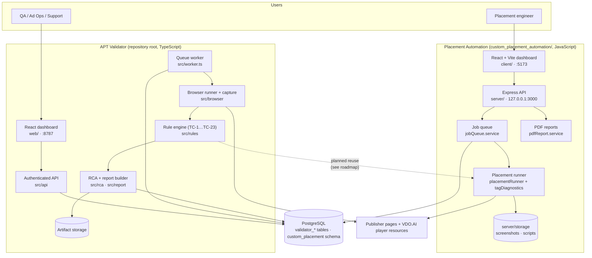

| | APT Validator | Placement Automation |
| --- | --- | --- |
| Question it answers | "Is this live integration correct according to the 23 cases?" | "Does my new placement JS or CSS put the player on these pages?" |
| Code under test | The publisher's real page and scripts | Your `vdo.ai.js` (replaces the tag's script) or `style.css` (injected) |
| Input | Approved URL, integration profile, device | Domain, tag, up to 50 URLs, devices, uploaded/pasted code |
| Output | 23 case verdicts, evidence timeline, probable causes, JSON/HTML report | PASS / FAIL / ERROR per URL, reasons, two screenshots, diagnostics, PDF |
| Language / stack | TypeScript, Node 24+, `pnpm`, `playwright-core` | JavaScript, Node 20+, `npm`, Express, Playwright, React + Vite |
| Access | Team tokens, team-scoped history | Local only (loopback, no login) |
| Database | `validator_*` tables via `db/migrations` | Its own `custom_placement` schema, created on start |
| Port | `127.0.0.1:8787` | API `127.0.0.1:3000`, dev UI `:5173` |

## Repository layout

```
.
├── src/                         APT Validator (TypeScript)
│   ├── api/                     authenticated HTTP API, batches, static dashboard
│   ├── browser/                 Chromium run, network/DOM capture, URL policy, articles
│   ├── evidence/                evidence normalisation and backend correlation
│   ├── logger/                  logger payload parsing and backend client
│   ├── rules/                   one module per rule family (TC-1…TC-23)
│   ├── rca/                     probable-cause ranking
│   ├── report/                  report build and redacted export
│   ├── ai/                      optional AI explanation (cannot change verdicts)
│   ├── pilot/ production/ deploy/   pilot evaluator, production contract, acceptance
│   ├── store.ts  worker.ts      PostgreSQL store and leased queue worker
│   └── cli.ts
├── web/                         APT Validator dashboard (React)
├── config/                      versioned rule, policy, device and profile configuration
├── db/migrations/               APT Validator schema
├── tests/                       APT Validator tests and fixture pages
├── docs/                        product, operations and planning documentation
└── custom_placement_automation/ Placement Automation
    ├── server/                  Express API, queue, Playwright runner, PDF, tests
    ├── client/                  React + Vite dashboard
    ├── vdo.ai.js                sample placement build
    ├── LOCAL-VALIDATION-PLAN.md 23-case mapping and delivery stages
    └── SETUP.md
```

## Application 1 — APT Validator

### How a validation works

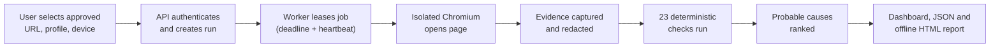

1. The user signs in with a team token.
2. The user selects an approved page, integration profile and device.
3. The API creates a bounded job with a deadline.
4. A worker claims the job with a lease and keeps it alive with heartbeats.
5. Chromium loads the page and records permitted evidence (network, DOM, logger, timing, layout, screenshots).
6. Evidence is normalised, and the rule engine compares it with the approved profile.
7. The RCA engine groups dependent symptoms and ranks supported causes.
8. Results, evidence references and causes are stored; the dashboard offers JSON or offline HTML export.

### Inside one run: the evidence pipeline

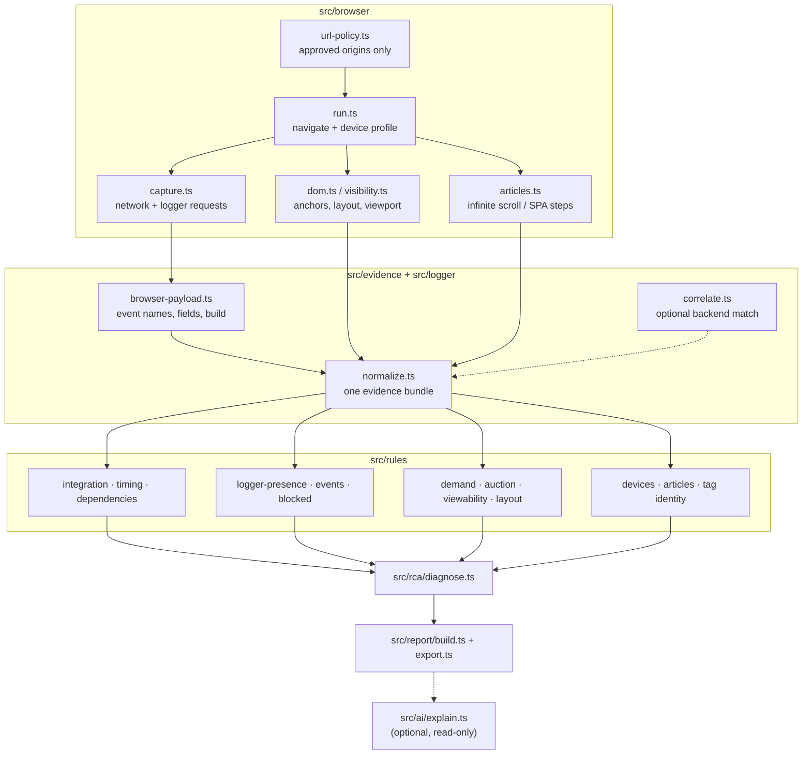

### Run lifecycle

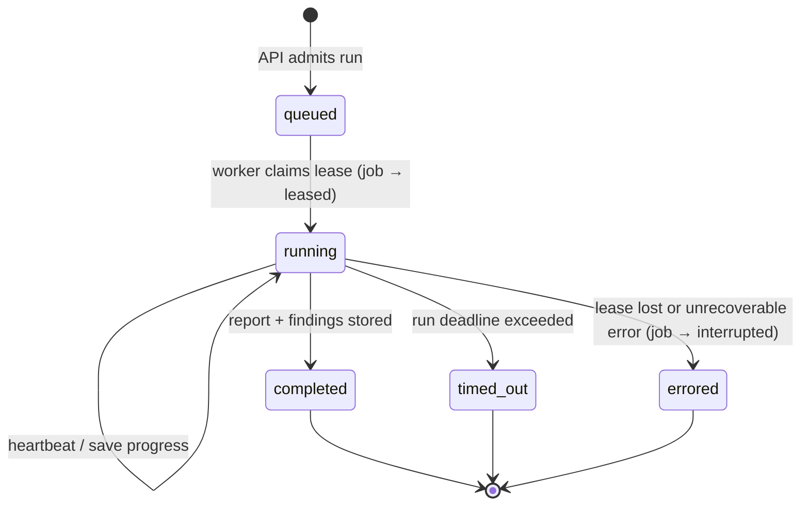

`validator_runs.execution_state` moves through `queued → running → completed | timed_out | errored`; the matching `validator_jobs.state` is `queued → leased → completed | interrupted`.

### Components

| Component | Purpose |
| --- | --- |
| Dashboard (`web/`) | Submit tests and inspect history, coverage, failures, evidence and probable causes |
| Authenticated API (`src/api`) | Identity, team boundaries, run admission, batches, status, reports and artifact access |
| PostgreSQL (`db/migrations`) | Profiles, runs, leased jobs, evidence metadata, findings, artifact references, batches |
| Queue worker (`src/worker.ts`) | Claims jobs, enforces deadlines and leases, coordinates browser execution |
| Browser runner (`src/browser`) | Opens the publisher page with real Chromium and collects bounded evidence |
| Rule engine (`src/rules`) | Applies versioned, deterministic rules to the captured evidence |
| RCA engine (`src/rca`) | Groups dependent symptoms and ranks supported causes without inventing evidence |
| Artifact storage | Bounded screenshots, sanitised network evidence and report artifacts |
| Logger collector (`src/logger/client.ts`) | Optionally retrieves authorised server-side logger records |
| Report exporter (`src/report`) | Redacted JSON and self-contained HTML reports |
| Pilot evaluator (`src/pilot`) | Accuracy, latency, completeness, cost and release gates from a labelled corpus |

### Data model

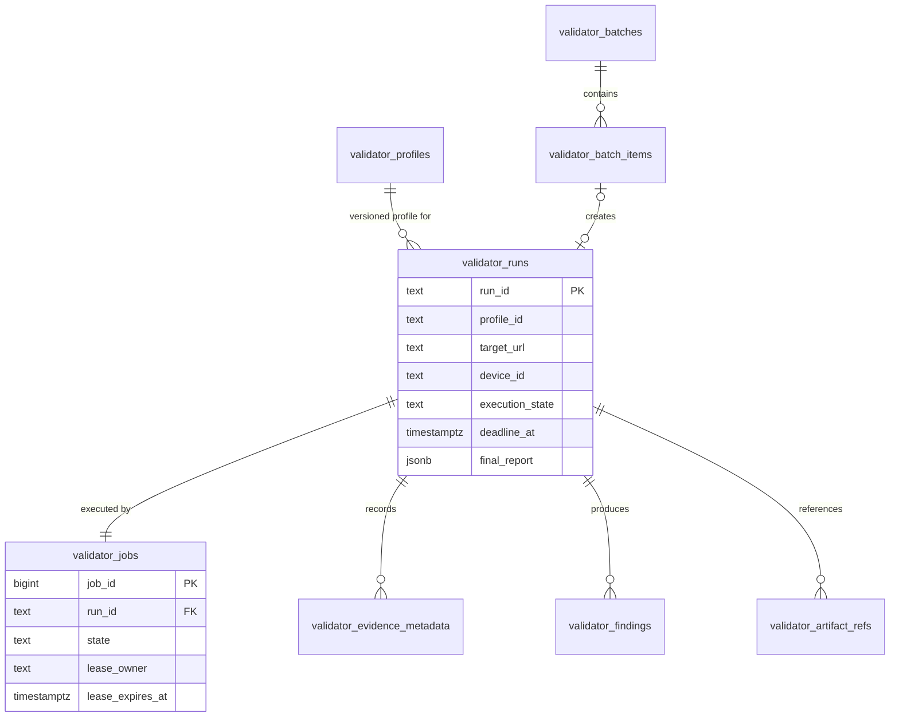

## Application 2 — Placement Automation

Placement Automation lets an engineer test new placement logic on real publisher pages **before** it ships. You give it a domain, a tag, a list of article URLs and either a `vdo.ai.js` build or a `style.css`. Full details are in [custom_placement_automation/README.md](custom_placement_automation/README.md).

### Two kinds of checks

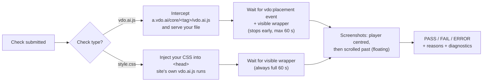

For `vdo.ai.js` checks, your placement code reports its own outcome:

```js
window.dispatchEvent(new CustomEvent('vdo:placement', {
  detail: { success: placed } // true only if the player was actually inserted
}));
```

### Request flow

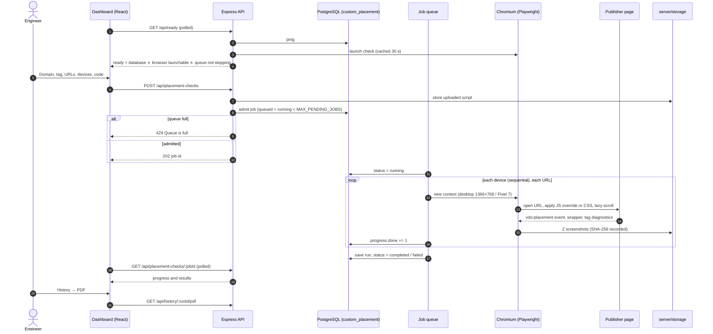

### Job lifecycle and restart recovery

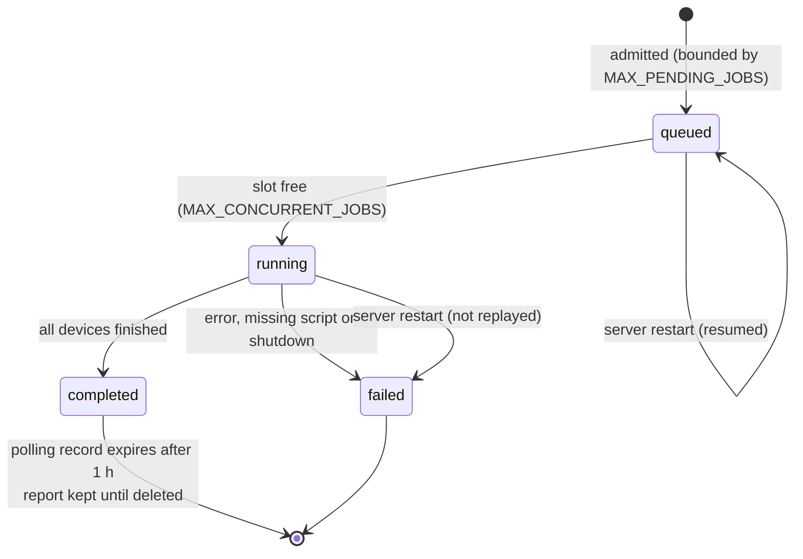

Queued jobs resume after a restart. A job that was running is marked failed, with completed-device results kept, rather than silently replayed — a replay could re-serve an ad. A PostgreSQL advisory lock ensures only one server owns the schema at a time.

### Result for one URL

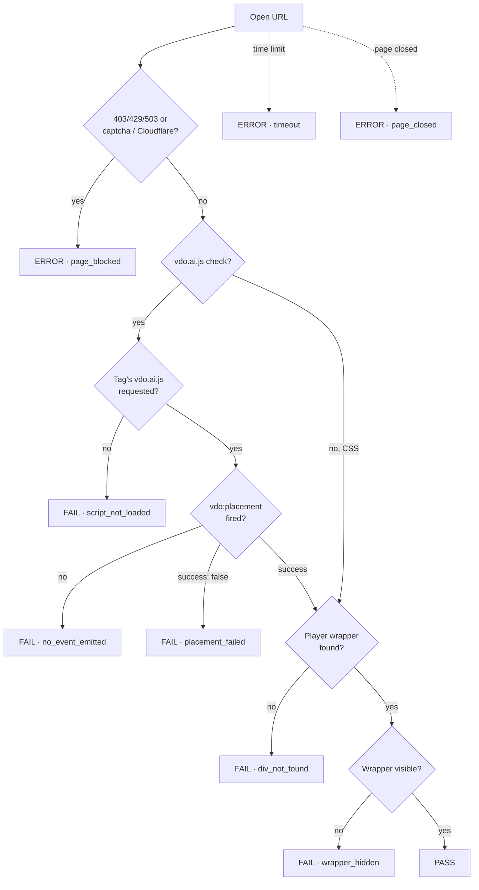

The chart shows the main path. In practice every failing condition is recorded, so one URL can carry several reasons (for example `script_not_loaded` and `div_not_found`).

### Server modules

| Module | Responsibility |
| --- | --- |
| `server/src/app.js` | Express app; rejects any non-loopback Host or Origin; serves `client/dist` when built |
| `routes/`, `controllers/` | `/api/health`, `/api/ready`, `/api/settings`, `/api/placement-checks`, `/api/history` |
| `services/database.service.js` | `custom_placement` schema, job admission, advisory lock, restart recovery, one-time `reports.json` import |
| `services/jobQueue.service.js` | Bounded queue, concurrency limit, progress persistence, graceful drain |
| `services/browser.service.js` | Shared Chromium, device profiles, cached launch readiness |
| `services/placementRunner.service.js` | Opens pages, applies code, scrolls, detects placement, takes screenshots |
| `services/tagDiagnostics.service.js` | Records `vdo.ai.js`, `vdo.min.js`, `ima3.js`, agent, analytics events, tag errors, console |
| `services/results.service.js` | Saves runs to PostgreSQL and screenshots to disk |
| `services/scriptStore.service.js` | Stores uploaded scripts for Re-run |
| `services/pdfReport.service.js` | PDF reports in a separate Chromium |

### API

| Method | Path | Purpose |
| --- | --- | --- |
| GET | `/api/health` | Liveness |
| GET | `/api/ready` | Database, queue and real Chromium launch readiness (503 until all are ready) |
| GET | `/api/settings` | Default scroll settings, limits and per-URL time limit |
| POST | `/api/placement-checks` | Start a check; returns a job (429 when the queue is full) |
| GET | `/api/placement-checks/:jobId` | Job progress and results |
| GET | `/api/history` | List runs (`?page=&pageSize=`) |
| GET | `/api/history/:runId` | One run with its results |
| GET | `/api/history/:runId/pdf` | Download the run as a PDF |
| DELETE | `/api/history/:runId` | Delete one run and its screenshots |
| DELETE | `/api/history` | Delete all runs, screenshots and stored scripts |

## Bringing the 23 cases into Placement Automation

The 23 validators already exist in the APT Validator. The plan in [LOCAL-VALIDATION-PLAN.md](custom_placement_automation/LOCAL-VALIDATION-PLAN.md) connects them to Placement Automation in stages. Until then, a placement PASS must **never** be counted as a pass for any of the 23 cases.

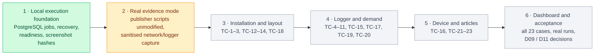

| Stage | Status |
| --- | --- |
| 1. Local execution foundation | Implemented |
| 2. Real evidence / production observation mode | In progress — dashboard readiness now uses a real Chromium launch; cancellation, per-URL checkpoints and evidence retention pending |
| 3–5. Case integration | Connected as the opt-in **deep test**: all 23 cases run per URL from the placement dashboard ([details](custom_placement_automation/README.md#deep-test-all-23-cases)) |
| 6. Dashboard and acceptance | Dashboard done; live publisher acceptance and confirmed policies pending |

Each case maps to an existing module under `src/` (for example TC-1 → `rules/integration.ts`, TC-14 → `rules/layout.ts`, TC-23 → `rules/articles.ts`); the full table is in the plan.

## The 23 test cases

| Case | Plain-language check |
| --- | --- |
| TC-1 | Is the correct VDO.AI tag and loader script present and successfully loaded? |
| TC-2 | Did the loader script finish within the approved timing bands? |
| TC-3 | Did each tag load only once without duplicate scripts or anchors? |
| TC-4 | Are browser logger requests being sent successfully? |
| TC-5 | Does the observed logger event journey match an approved served-ad or no-ad flow? |
| TC-6 | Are all events required for this page, product, and outcome present? |
| TC-7 | Is Pageview emitted once per active tag and Website Pageview within its allowed count? |
| TC-8 | Is the player correctly classified above or below the fold, and does it report entering view? |
| TC-9 | Does an eligible player initiate the expected ad request? |
| TC-10 | Where does the ad-serving chain first stop, and was viewable exposure achieved? |
| TC-11 | Were player, inline, autoplay, IMA, agent, device, URL, or coded errors blocked as expected? |
| TC-12 | Did every dependency required by the selected product load successfully? |
| TC-13 | Are the correct anchor and external script present in the intended page location? |
| TC-14 | Did the player form correctly, and is publisher CSS hiding, clipping, or covering it? |
| TC-15 | How long did logger requests take, and where are repeated delays visible? |
| TC-16 | Does the integration behave correctly on the required desktop and mobile profiles? |
| TC-17 | Do logger tag, domain, page URL, and dependency values agree with observed page evidence? |
| TC-18 | Does the approved tag belong to the configured domain and product? |
| TC-19 | Does the dependency build stay consistent throughout one physical page load? |
| TC-20 | Are logger event names and the five required fields present and valid? |
| TC-21 | Does each logger event carry the article URL that was current when the request began? |
| TC-22 | Does each tag emit one loaded and one Pageview event for each article? |
| TC-23 | Does validation remain correct through at least three infinite-scroll or SPA articles? |

Every result retains expected and observed values, evidence references, applicability and limitations. Detailed acceptance scenarios are in [case coverage](docs/plan/CASE-COVERAGE.md).

## Result meanings

**APT Validator**

| Result | Meaning |
| --- | --- |
| `PASS` | The required behaviour was observed with sufficient evidence |
| `FAIL` | Evidence shows that a required rule was violated |
| `WARNING` | A risk or provisional threshold breach that may not be a defect |
| `UNKNOWN` | The evidence or approved policy is insufficient for a conclusion |
| `NOT APPLICABLE` | The rule does not apply to the selected product, device or scenario |

Demand, publisher implementation, runtime/browser, configuration and coverage problems stay separate. A no-fill response is not automatically blamed on the publisher.

**Placement Automation** reports `PASS`, `FAIL` or `ERROR` per URL with a reason code (`script_not_loaded`, `no_event_emitted`, `placement_failed`, `div_not_found`, `wrapper_hidden`, `page_blocked`, `timeout`, `page_closed`). These describe placement only, not the 23 cases.

## Getting started

### APT Validator

Requirements: Node.js 24+, `pnpm`, PostgreSQL, and an installed Chromium for browser-level testing.

```bash
pnpm install
pnpm typecheck
pnpm test
```

Set `DATABASE_URL`, `VDO_VALIDATOR_API_IDENTITIES` and `VDO_VALIDATOR_ARTIFACT_ROOT`, then:

```bash
pnpm db:migrate
pnpm api
```

Open `http://127.0.0.1:8787`, enter an authorised team token, submit an approved fixture profile and URL, choose a device, and follow the run until its report is available. From the dashboard you can submit single runs or bounded batches, monitor progress, review coverage and verdicts, inspect the evidence timeline and probable causes, and download redacted JSON or offline HTML.

### Placement Automation

Everyday use, one command from the repository root (updates from GitHub, asks for the PostgreSQL settings the first time, installs and builds only what changed, starts on http://127.0.0.1:3000):

```bash
npm run app            # or double-click "Start VDO Tool.cmd" on Windows
```

Developer setup: Node.js 20+, `npm`, and a local PostgreSQL database role that can create the `custom_placement` schema.

```bash
cd custom_placement_automation
npm run setup || bash setup.sh          # installs server, client and Chromium, creates server/.env
# edit server/.env and set DATABASE_URL
npm start                               # API on 127.0.0.1:3000, UI on http://localhost:5173
```

The dashboard enables checks only when `/api/ready` reports the database, queue and Chromium launch as ready. If Chromium is missing, run `npm --prefix server run browsers:install`; the dashboard picks it up automatically. See [SETUP.md](custom_placement_automation/SETUP.md) for troubleshooting.

Database tests: set `TEST_DATABASE_URL` and run `npm --prefix server test`. They use an isolated `placement_test_*` schema that is removed afterwards.

Further guides: [product guide](docs/product-guide.md), [API](docs/api.md), [dashboard](docs/dashboard.md), [batches](docs/batches.md), [report export](docs/report-export.md).

## Deployment strategy

Placement Automation is a **local, trusted-admin tool** and is not designed to be network-hosted. The APT Validator is deployed in two controlled stages.

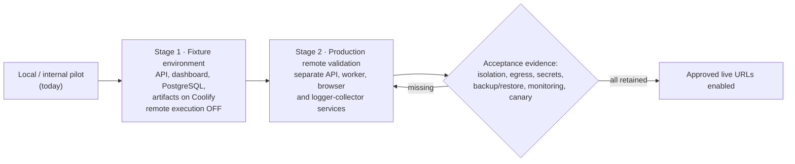

In Stage 2 the browser runs on a separate server with no database, API, artifact, logger, Docker, cloud or Coolify credentials. It may reach only approved public destinations; private, loopback, link-local, metadata and control-plane networks are denied.

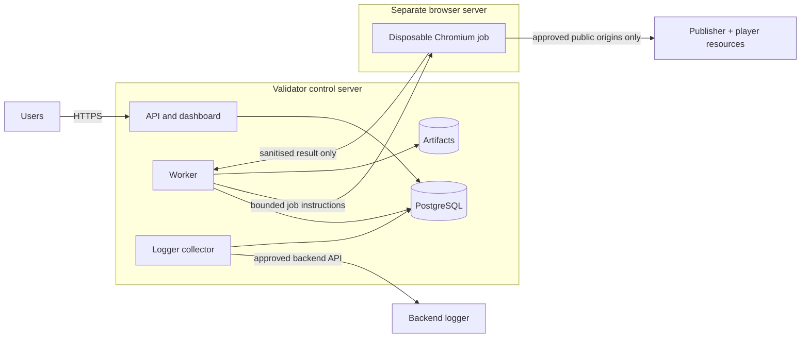

The exact procedure is in the [Coolify self-hosting plan](docs/coolify-self-hosting.md), the [operations runbook](docs/operations.md) and the [production delivery backlog](docs/plan/PRODUCTION-DELIVERY.md).

## Security and evidence principles

- Only approved URLs and resource origins may be tested; destinations are checked after DNS resolution.
- Private, loopback, link-local and metadata destinations are rejected.
- Chromium receives no database, API or logger credentials.
- Tokens and sensitive query values are redacted from retained evidence.
- Team boundaries protect APT Validator runs, reports and artifacts.
- Placement Automation listens only on `127.0.0.1` and rejects non-local Host/Origin headers; it is not a sandbox for untrusted uploaded JavaScript.
- Output is bounded by time, size and count limits.
- AI can explain existing findings but cannot create or alter verdicts.
- Synthetic fixtures verify code behaviour but do not prove live publisher correctness.

## Development roadmap

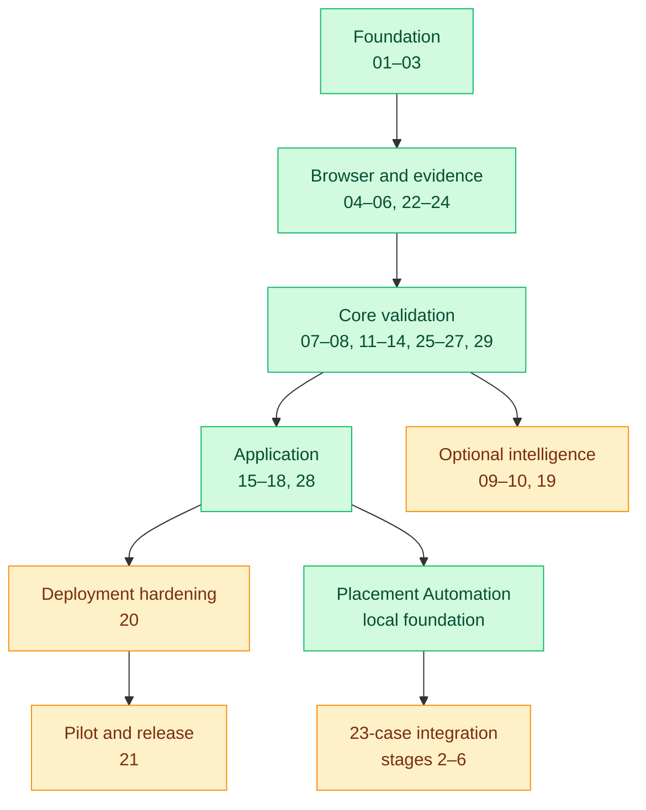

| Phase | Tasks | Outcome | Status |
| --- | --- | --- | --- |
| Foundation | 01–03 | Supported integration, shared contracts, controlled page scenarios | Implemented locally |
| Browser and evidence | 04–06, 22–24 | Bounded Chromium runs, evidence, logger parsing, identities, normalisation, timing | Implemented locally |
| Core validation | 07–08, 11–14, 25–27, 29 | All 23 checks, demand/auction/layout/article/device rules, reports, RCA | Implemented locally |
| Application | 15–18, 28 | PostgreSQL queue, authenticated API, dashboard, exports, batch validation | Implemented locally |
| Optional intelligence | 09–10, 19 | Backend verification, exact correlation, bounded AI explanation | Implemented locally; live integrations unverified |
| Deployment hardening | 20 | Network safety, admission controls, health, credential separation, recovery | Application hardening done; deployment acceptance pending |
| Pilot and release | 21 | Labelled-corpus evaluation and evidence-backed release decision | Evaluator implemented; real pilot inputs pending |
| Placement Automation | — | Durable local placement backend, readiness, 23-case mapping | Stage 1 done; stage 2 in progress |

The authoritative task order and handoff are in [TASKS.md](docs/plan/TASKS.md) and [STATUS.md](docs/plan/STATUS.md).

## Documentation map

- [Non-technical product guide](docs/product-guide.md)
- [Placement Automation README](custom_placement_automation/README.md), [setup](custom_placement_automation/SETUP.md), [Windows step-by-step install](custom_placement_automation/INSTALL-WINDOWS.md) and [local validation plan](custom_placement_automation/LOCAL-VALIDATION-PLAN.md)
- [Coolify self-hosting plan](docs/coolify-self-hosting.md)
- [Dashboard use](docs/dashboard.md)
- [Report exports](docs/report-export.md)
- [Bulk validation](docs/batches.md)
- [Desktop, mobile and real-iOS validation](docs/device-validation.md)
- [PostgreSQL and worker](docs/persistence.md)
- [Support and pilot runbook](docs/support-runbook.md)
- [Pilot results and release status](docs/pilot-results.md)
- [Detailed case coverage](docs/plan/CASE-COVERAGE.md)
- [Implementation status](docs/plan/STATUS.md)

## Known limitations

- No approved production profile, live publisher corpus or real demand capture has been supplied.
- Production service separation and Coolify deployment acceptance are not complete.
- The 23 cases are not yet executed by Placement Automation; its PASS covers placement only.
- Placement Automation has no login, does not resume a URL interrupted mid-run, and some sites block automated browsers (`page_blocked`). `script_not_loaded` is common where the ad slot does not always fill.
- Real iOS/Safari evidence is required for iOS-specific conclusions; Chromium mobile emulation does not replace it.
- Some thresholds and lifecycle rules remain draft until product owners confirm decisions D01–D14.
- Backend logger verification requires authorised credentials and a confirmed shared identifier.
- Tablet and connected-TV profiles are deferred.
- Pilot accuracy, time saving and release metrics cannot be claimed before the labelled corpus is evaluated.

Both applications are safe by default: missing evidence produces `UNKNOWN`, `ERROR` or an explicit coverage gap rather than a fabricated pass, failure or cause.
